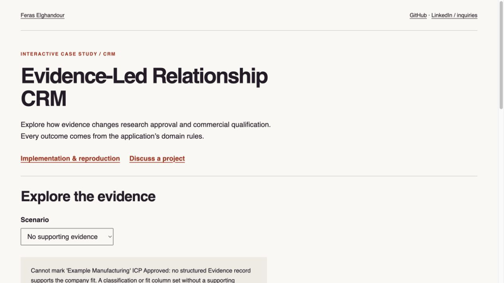
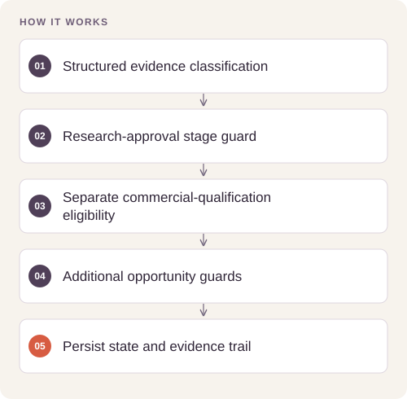

# Evidence-Led Relationship CRM

**Feras Elghandour**

Keep company fit, observed engagement, lead qualification, and sales opportunities distinct and supported by evidence.

**[Explore the interactive demonstration](https://feraselghandour.github.io/evidence-led-relationship-crm/)** · [Operating scope](OPERATIONS.md)

[](https://feraselghandour.github.io/evidence-led-relationship-crm/)

## Implementation

A local Streamlit application backed by SQLAlchemy and SQLite. Explicit state-transition gates protect qualification; employment history is retained; structured evidence supports opportunities; and historical imports are separated from experiment-period metrics.




## Reproduce and inspect

The executable reproduction profile now records exact commands, input/source hashes, dependency versions, logs and pass/fail status. Its scope distinguishes behavior checks from full-data benchmarks.

[Commands, artifacts and benchmark scope](BENCHMARKS.md) · [Versioned profiles](reproduction.json)


## Try a small example

Fictional records exercise actual stage guards. An inference may support research approval without qualifying an opportunity; classification does not establish factual truth.

After the local setup below, run from the repository root:

```sh
python examples/quickstart.py
```

The [example source](examples/quickstart.py), [captured output](examples/expected-output.txt) and [execution record](examples/environment.json) keep this demonstration inspectable. Floating-point values may vary with library versions.

Observed output from this run:

```text
[{'name': 'No supporting evidence', 'classification': None, 'research_approved': False, 'qualifying_classification': False, 'scope': 'Classification eligibility does not by itself create an opportunity or verify factual truth.'}, {'name': 'Unsupported assumption', 'classification': 'Unsupported Assumption', 'research_approved': False, 'qualifying_classification': False, 'scope': 'Classification eligibility does not by itself create an opportunity or verify factual truth.'}, {'name': 'Research inference', 'classification': 'Inference', 'research_approved': True, 'qualifying_classification': False, 'scope': 'Classification eligibility does not by itself create an opportunity or verify factual truth.'}, {'name': 'Confirmed synthetic fact', 'classification': 'Confirmed Fact', 'research_approved': True, 'qualifying_classification': True, 'scope': 'Classification eligibility does not by itself create an opportunity or verify factual truth.'}]
```

## Evidence and results

**71 tests pass** across stage gates, unsupported assumptions, deduplication, employment history, action/outcome timelines, and measurement boundaries. The public edition starts empty: private companies, contacts, research seed records, and the original database are excluded.

## Run locally

Python 3.11 or later; use an isolated environment.

```sh
python -m pip install -r requirements.txt
python -m pytest -q
python run.py
```

The app opens at `http://localhost:8501`. `ICP_CRM_DATABASE_URL` selects an alternate database. Public defaults disable private-data seeding. Add authorized records manually through the local interface; CSV import/export helpers remain available.

## Scope and limitations

A local single-user application. It does not automate outreach, scrape profiles, or provide a production authentication layer. No generated leads, attributable sales, or commercial uplift is claimed from test success.

[Validation record](VALIDATION.md) · [Inputs and applicable notices](DATA.md)

## Rebuild the public demonstration

Run `python demo/generate.py` to execute the synthetic scenarios through the actual implementation, then `python build_report.py`. The hosted page is a static evidence explorer; the Python application and full experiments run separately.
