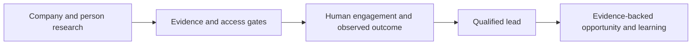

# Evidence-Led Relationship CRM

**Feras Elghandour**

Keep company fit, observed engagement, lead qualification, and sales opportunities distinct and supported by evidence.

## Implementation

A local Streamlit application backed by SQLAlchemy and SQLite. Explicit state-transition gates protect qualification; employment history is retained; structured evidence supports opportunities; and historical imports are separated from experiment-period metrics.



## Evidence and results

**71 tests pass** across stage gates, unsupported assumptions, deduplication, employment history, action/outcome timelines, and measurement boundaries. The public edition starts empty: private companies, contacts, research seed records, and the original database are excluded.

## Run locally

Python 3.11 or later; use an isolated environment.

```sh
python -m pip install -r requirements.txt
python -m pytest -q
python run.py
```

The app opens at `http://localhost:8501`. `ICP_CRM_DATABASE_URL` selects an alternate database. Public defaults disable private-data seeding. Add authorized records manually through the local interface; CSV import/export helpers remain available.

## Scope and limitations

A local single-user application. It does not automate outreach, scrape profiles, or provide a production authentication layer. No generated leads, attributable sales, or commercial uplift is claimed from test success.

[Validation record](VALIDATION.md) · [Inputs and applicable notices](DATA.md)
